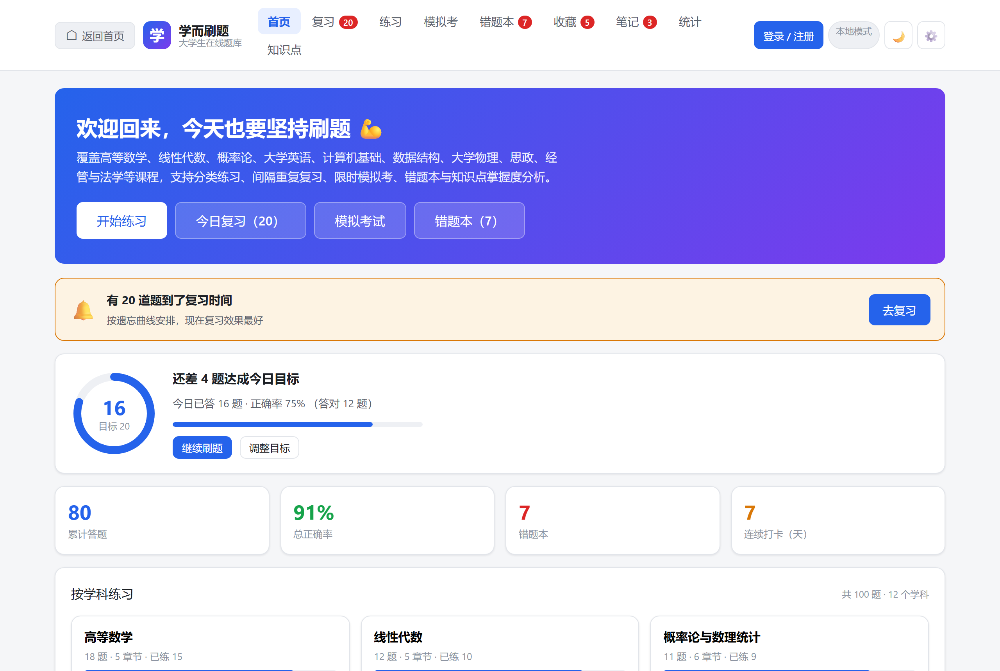
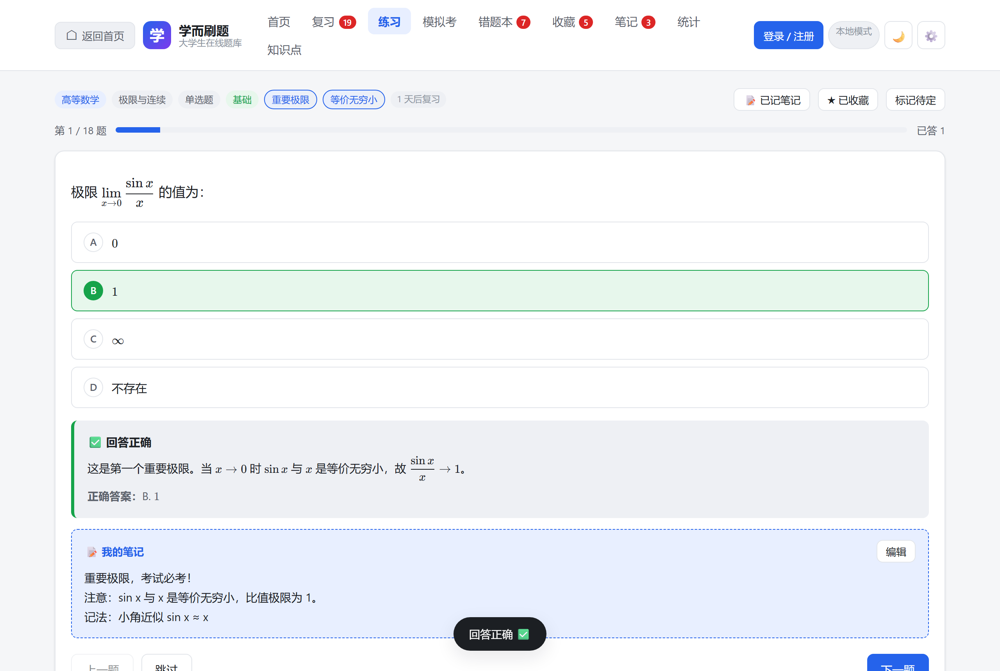
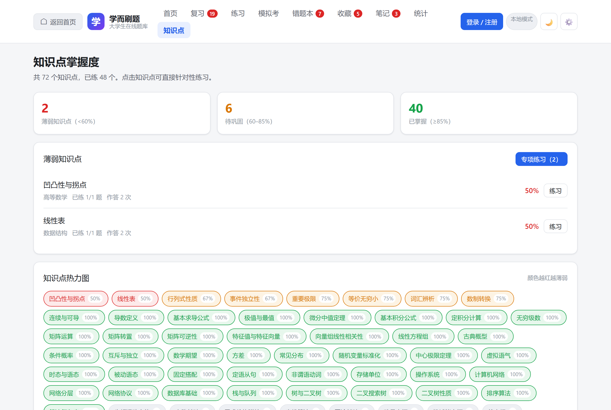
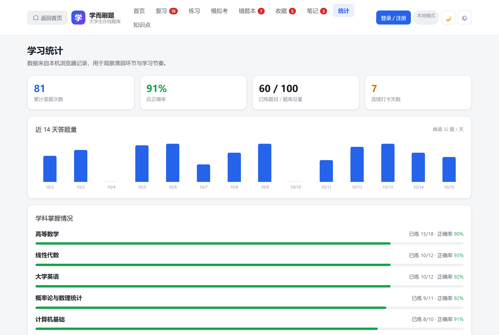
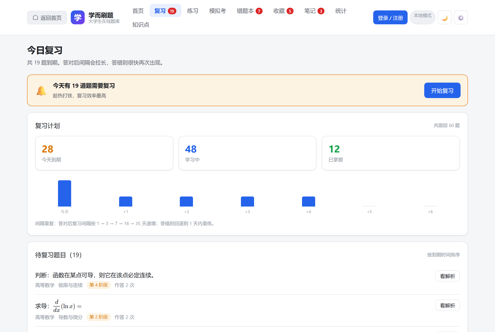
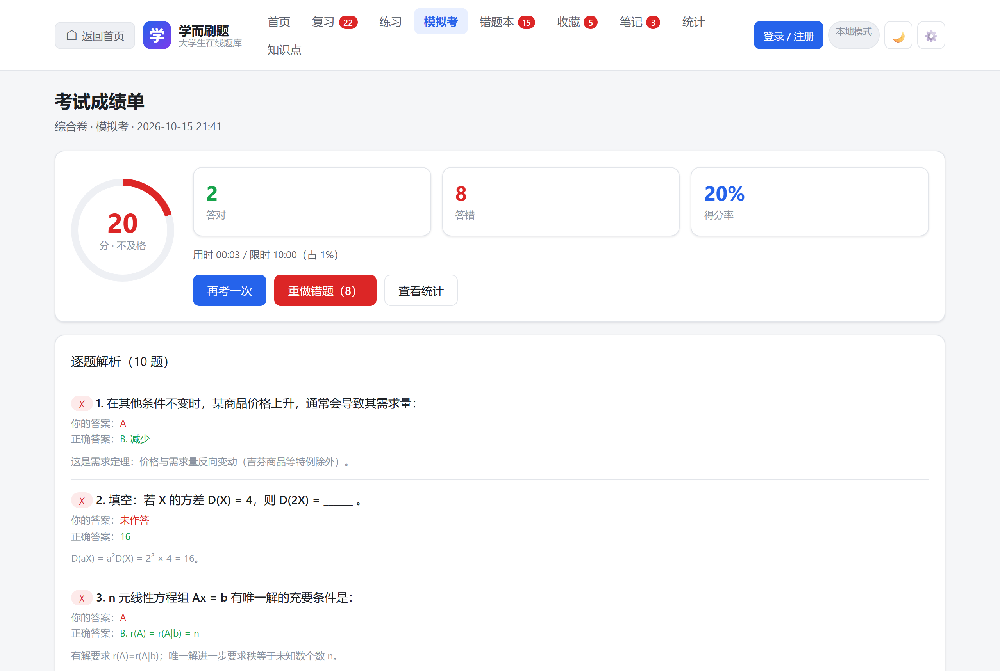
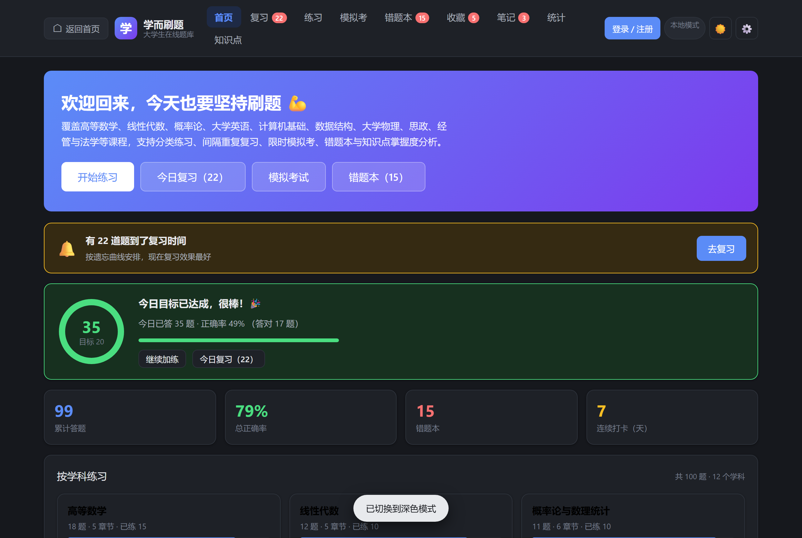

# 学而刷题 · 大学生在线刷题系统

面向在校大学生的刷题系统。支持**用户登录**、**服务端题库**、**多设备进度同步**，也可在无服务端时降级为纯本地模式使用。

## 界面预览

**首页** —— 每日目标进度环、复习提醒、学科掌握度一览：



**答题页** —— KaTeX 公式渲染、即时判分与解析、个人笔记：



**知识点掌握度** —— 72 个知识点的彩色热力图，点击可专项练习：



**学习统计** —— 近 14 天答题量、学科正确率：



**今日复习** —— 间隔重复调度，按遗忘曲线安排：



**模拟考成绩单** —— 得分环与逐题解析：



**深色模式**：



**核心特性**

- 零运行时依赖 —— 只用 Node.js 内置模块，不需要 `npm install` 即可运行
- 100 道题 / 12 学科 / 48 章节，含单选、多选、判断、填空四种题型
- 数学公式渲染（内置 KaTeX，无 CDN 依赖，可完全离线）
- 间隔重复复习（简化版 SM-2），按遗忘曲线安排复习
- 知识点掌握度热力图
- 一键启动（Windows 双击 `.cmd`，自动找 Node、自动开浏览器）
- 514 项自动化测试，含真实浏览器交互测试

## 快速开始

```bash
git clone <本仓库地址>
cd quiz-system

# Windows：双击 启动刷题系统.cmd
# 其他平台：
node server/server.js
```

浏览器会自动打开 <http://localhost:3000>。

> 不想装 Node.js？直接双击 `index.html` 也能用（本地模式，数据存在浏览器里）。

## 两种运行方式

### 方式一：一键启动（推荐，带登录与多设备同步）

**Windows**：直接双击 **`启动刷题系统.cmd`**，浏览器会自动打开，无需任何命令。

启动器会自动完成这些事：

- 在 PATH、常见安装位置、内置运行时中查找 Node.js
- 端口被占用时自动顺延（3000 → 3001 → …），不必手动改配置
- 启动后自动打开默认浏览器
- 切换控制台为 UTF-8，避免中文提示乱码

如果没装 Node.js，启动器会给出安装指引，并提供「以本地模式打开」的选项。

> **安装 Node.js**：从 <https://nodejs.org/> 下载 LTS 版本即可。
> 若无法运行安装程序（例如没有管理员权限），可下载 **Windows 二进制 zip 包**，
> 解压到 `%LOCALAPPDATA%\Programs\nodejs`，再把该目录加入用户 `PATH` —— 全程无需管理员权限。
> 启动器会自动在 PATH、常见安装位置与内置运行时中查找，因此放在这个目录即可被识别。

**macOS / Linux**：

```bash
cd quiz-system
node server/server.js
```

浏览器会自动打开；不想自动打开可加 `--no-open`。

首次启动会自动创建 `server/data/` 并把内置题库播种到服务端。

### 方式二：本地模式

直接双击 `index.html`（或拖进浏览器）即可。无需服务端，数据保存在浏览器 `localStorage`。

> 前端会自动探测服务端：探测不到就进入本地模式，启动服务端后刷新页面即自动切换。

## 功能一览

| 模块 | 说明 |
| --- | --- |
| **一键启动** | Windows 双击 `启动刷题系统.cmd` 即可，自动找 Node、自动开浏览器、端口占用自动顺延 |
| **用户登录** | 注册 / 登录 / 登出，密码经 scrypt 加盐哈希存储，会话 7 天有效 |
| **服务端题库** | 题库存于服务端，支持按学科/章节/知识点/题型/难度筛选、关键词搜索、分页拉取 |
| **进度同步** | 登录后自动同步；**合并式写入**，多设备交替刷题零丢失（见下文） |
| **每日目标** | 设定每天做题量，首页显示完成进度环与近 14 天达成日历，可跨设备同步 |
| **个人笔记** | 每道题可写笔记（支持 LaTeX 公式），复习时自动显示；LWW 合并，多端编辑不冲突 |
| **分类练习** | 按学科/章节/知识点/题型/难度筛选，可选数量与出题顺序（随机、错题优先、未做过优先） |
| **数学公式** | 内置 KaTeX，题干/选项/解析支持 `$...$` 与 `$$...$$` LaTeX 公式 |
| **间隔重复** | 简化版 SM-2：答对后间隔按 1→3→7→16→35 天递增，答错快速回炉；首页提示「今日复习」 |
| **知识点掌握度** | 每题标注知识点，按知识点统计正确率并生成热力图，可一键专项练习 |
| **即时判分** | 选择题点选即判、多选题与填空题点「提交本题」判分，立即显示解析 |
| **模拟考试** | 限时作答、不显示答案、可标记待定，交卷后生成成绩单与逐题解析，时间到自动交卷 |
| **错题本** | 答错自动收录，重做答对标记「已订正」但保留供复习 |
| **收藏夹** | 一键收藏重点题，可整组练习 |
| **学习统计** | 累计答题、正确率、连续打卡、近 14 天柱状图、学科掌握度、薄弱章节 TOP |
| **数据管理** | 学习数据导出 / 导入 JSON |
| **个性化** | 深色 / 浅色主题、字号调节、自动跳题开关 |

### 键盘快捷键

| 按键 | 作用 |
| --- | --- |
| `H` | **返回首页** |
| `A`~`F` 或 `1`~`6` | 选择对应选项 |
| `←` / `→` | 上一题 / 下一题 |
| `Enter` | 提交填空答案 |
| `Esc` | 关闭解析弹窗 |

## 性能与资源限制

系统做过一轮基于**实测**的优化，以下是审计脚本给出的数据（`npm run audit:perf` 可复现）：

| 项目 | 优化前 | 优化后 |
| --- | --- | --- |
| `/api/questions` 传输 | 36.7 KB | **12.0 KB**（brotli，省 67%） |
| 首屏关键资源传输 | 509 KB | **139 KB**（省 73%） |
| 静态资源二次访问 | 完整重传 | **304 协商缓存，0 字节** |
| 8 个并发注册 | 215 ms（串行化） | **67 ms**（真正并发） |
| 哈希期间轻量请求 | 被阻塞 ~26 ms | **5 ms**（不受影响） |
| daily 存储 | 无上限 | 400 天 |
| notes 存储 | 无上限 | 5000 条 / 1 MB |
| 请求体超限 | 连接被重置 | **413 + 可读提示** |
| 注册接口 | 无限流 | 每 IP 每小时 10 次 |

### 具体做了什么

**1. 响应压缩**（`server/compress.js`）
按 `Accept-Encoding` 协商，优先 Brotli、兜底 gzip。只压缩文本类且 ≥1 KB 的响应；
压缩结果按 ETag 缓存在内存中，同一版本只压缩一次（`katex.min.js` 有 276 KB，重复压缩会浪费 CPU）。

**2. 协商缓存**
静态资源带 `ETag` 与 `Last-Modified`，命中时返回 304。原先每次刷新都要完整重传。

**3. 密码哈希改异步**（`server/auth.js`）
`scryptSync` 单次约 26 ms，期间**完全阻塞事件循环**。改用异步 `crypto.scrypt` 后
哈希在线程池执行，8 个并发注册从 215 ms 降到 67 ms，且轻量请求不再被拖慢。

**4. 数据裁剪**（`js/merge.js` 的 `pruneProgress`）
`daily` 保留 400 天、`notes` 保留 5000 条且总字节 ≤1 MB。
裁剪是确定性的，因此**不破坏合并的交换律**。
前端在 `save()` 时也会裁剪，避免 `localStorage` 配额溢出与超大同步 payload。

**5. 请求体上限 512 KB → 2 MB**
实测重度用户（2000 条 × 200 字笔记）的进度对象约 558 KB，原先会同步失败。
超限时返回 **413 与明确提示**，而不是重置连接。

> 这里踩了两次坑，值得记录：第一版超限时 `req.destroy()`，客户端收到 ECONNRESET；
> 第二版改为 `req.pause()` 后立刻回 413，**仍然** ECONNRESET —— 因为客户端还在上传，
> 我们停止读取会填满 TCP 接收缓冲区，客户端写失败先于读到响应。
> 现版本超限后**继续消费并丢弃**剩余数据，等客户端写完再回 413；
> 另设 4× 硬上限，超过才强制断开。

**6. 接口限流**（`server/ratelimit.js`）
注册、登录、进度写入各自限流，防止脚本批量刷账号。
按 IP 计数；仅当显式设置 `QUIZ_TRUST_PROXY=1` 时才信任 `X-Forwarded-For`
（否则客户端可伪造该头绕过限流）。

**7. 会话定期清理**
`createSession` 只清理「登录那一刻」的过期会话，只读用户的会话会永久滞留。
新增每 30 分钟一次的定时维护。

**8. 前端渲染优化**
`stats()` 结果做缓存（一次渲染会调用多次，每次都遍历全部记录）；
`dueCount()` / `noteCount()` 改为直接计数，不再为取长度而做完整排序。

### 可调环境变量

| 变量 | 默认 | 说明 |
| --- | --- | --- |
| `QUIZ_BODY_LIMIT` | 2097152 | 请求体上限（字节） |
| `QUIZ_RL_REGISTER` | 10 | 每 IP 每小时可注册账号数 |
| `QUIZ_RL_LOGIN` | 30 | 每 IP 每 15 分钟登录尝试次数 |
| `QUIZ_RL_WRITE` | 120 | 每分钟进度写入次数 |
| `QUIZ_DISABLE_RATELIMIT` | — | 设为 `1` 关闭限流（仅测试用） |
| `QUIZ_TRUST_PROXY` | — | 设为 `1` 信任 `X-Forwarded-For` 并启用 `Secure` Cookie |
| `QUIZ_SECURE_COOKIE` | — | 设为 `1` 强制 Cookie 带 `Secure` |
| `ADMIN_TOKEN` | — | 设置后才启用 `/api/admin/reseed` |

## 常见问题

### 页面显示「没有题目」/ 空白

按以下顺序排查：

1. **强制刷新**：`Ctrl + Shift + R`（Mac 为 `Cmd + Shift + R`）。
   若浏览器缓存了旧版本 JS，会出现新旧不匹配。
   > 该问题已在 v3.1 修复：静态资源改为 `no-cache` + ETag 协商缓存，
   > 每次都会向服务端校验（命中时返回 304，几乎不耗流量），
   > 因此不会再拿到过期 JS。

2. **重置本地数据**：浏览器 F12 → Console 执行
   ```js
   localStorage.removeItem('xueer-quiz-v1'); location.reload();
   ```
   若本地数据被写坏（例如手工编辑过、或写入过程被中断），旧版本会因此渲染失败。
   > 该问题已在 v3.1 修复：现在会逐字段校验类型，坏字段回退默认值，
   > 不会影响其他数据，也不会导致题目消失。

3. **确认题库文件完好**：`node tools/diag-bank.js` 会报告服务端题库的题目数量。

4. **查看控制台报错**：F12 → Console。若出现红色错误，把内容反馈即可定位。

### 双击启动器后浏览器没自动打开

浏览器可能被安全软件拦截。手动访问控制台里显示的网址即可（默认 `http://localhost:3000`）。
也可用 `启动刷题系统.cmd --no-open` 显式关闭自动打开。

### 端口被占用

启动器会自动顺延（3000 → 3001 → …），控制台会显示实际使用的端口。
也可指定端口：`启动刷题系统.cmd --port 8080`。

### 登录后进度没有同步

确认顶部标识显示「云端同步」而非「本地模式」。
若显示本地模式，说明服务端未启动——请用 `启动刷题系统.cmd` 而非直接双击 `index.html`。

## 每日目标

设定每天想做多少题，首页会显示完成进度环，下方是近 14 天的达成日历。

在「设置 → 每日目标」中可选题量（5–100 题）与时长（10–120 分钟），也可设为「不设目标」。
未设目标时首页会给出「设为每天 20 题」的快捷按钮。

目标配置随账号同步，多端取较新的一份。达成状态按**当天答题次数**计算
（同一题重做也计入，因为目标衡量的是练习量）。

## 个人笔记

做题时可以点右上角 **「📝 笔记」** 为这道题写下易错点、思路或公式推导。
笔记支持 LaTeX 公式，保存后：

- 该题解析下方会显示「我的笔记」，复习时对照复盘
- 「笔记」页面按学科汇总全部笔记，可一键练习所有有笔记的题
- 笔记随账号同步到其他设备

**冲突处理**：笔记是可编辑文本，不能用「取较大值」合并（那样删除和修改都会失效）。
因此采用 **Last-Write-Wins**：按 `updatedAt` 取较新的一条；时间戳相同时用文本长度做
确定性裁决，保证合并满足交换律。空文本表示用户主动删除 —— 该删除意图会被保留并同步，
否则在另一台设备上笔记会「复活」。

## 多设备同步：为什么不会丢数据

这是一个容易被忽视、后果却很严重的坑。早期实现是「答题后整体 PUT 覆盖」，会出现：

```
设备 A 答对 q-A  →  PUT（服务端 = {q-A}）
设备 B 基于旧视图答 q-B  →  PUT（服务端 = {q-B}）   ← q-A 被抹掉
```

修复方案分三层：

1. **答题走增量接口** `POST /api/progress/answer` —— 服务端做加法，天然无覆盖问题
2. **PUT 也改为合并** —— 服务端把提交内容与已有进度做**单调合并**（计数取较大值、集合取并集），而非覆盖
3. **合并逻辑前后端共用同一份代码** `js/merge.js` —— 避免两端规则漂移

合并函数具备**交换律与幂等性**，因此无论哪台设备、以什么顺序提交，结果都一致：

```js
merge(a, b) === merge(b, a)        // 交换律
merge(merge(a, a), a) === merge(a, a)  // 幂等
```

各字段的合并规则：

| 字段 | 规则 |
| --- | --- |
| `records` | attempts / correct / wrong 取较大值（单调不减） |
| `wrong` | count 取较大值；**两端都订正**才算已订正 |
| `favorites` | 并集，addedAt 取较早者 |
| `exams` | 按 id 去重，按时间倒序，最多 100 条 |
| `daily` | 逐日 answered / correct 取较大值 |
| `streak` | 天数取较大值，lastDate 取较晚者 |
| `review` | 取「阶段更大且到期更晚」的一方（不因同步而提前复习） |
| `notes` | **LWW**：按 updatedAt 取较新；空文本表示删除并保留该意图 |
| `goals` | 整体取 updatedAt 较新的一份配置 |

另有**离线重试队列**：上报失败时入队，恢复后自动补发，弱网环境下也不会丢记录。

`test/sync.test.js` 用 57 项断言固化这些不变量，包括 10 个并发提交零丢失、两台设备交替提交零丢失、混用两种接口零丢失、笔记 LWW 与删除意图同步。

## 数学公式

题干、选项、解析均支持 LaTeX，用 `$...$`（行内）或 `$$...$$`（块级）包裹：

```js
{
  stem: "求极限 $\\lim\\limits_{x \\to 0} \\dfrac{\\sin x}{x}$",
  options: ["$0$", "$1$", "$\\infty$", "不存在"],
  analysis: "由 $1 - \\cos x \\sim \\dfrac{x^2}{2}$ 可知……"
}
```

KaTeX 已本地化到 `vendor/katex/`（仅保留 woff2 字体，约 547 KB），**无 CDN 依赖，可完全离线使用**。

安全设置：渲染时显式 `trust: false`，禁用 `\href`、`\htmlClass`、`\includegraphics` 等危险指令；公式外的文本一律 HTML 转义。KaTeX 未加载时自动降级为转义原文，不影响做题。

## 间隔重复（简化版 SM-2）

每道做过的题都有复习计划：

| 阶段 | 间隔 | 说明 |
| --- | --- | --- |
| 0 | 当天 | 新题答对后 |
| 1 | 1 天 | |
| 2 | 3 天 | |
| 3 | 7 天 | |
| 4 | 16 天 | 视为「已掌握」 |
| 5+ | 35 / 75 / 150 天 | 长期记忆 |

答错则阶段回退、间隔缩短到 1 天内重练，并累计 `lapses`（遗忘次数）。

同步时取「阶段更大且到期更晚」的一方，保证**不会因同步而把复习计划提前**。

## 知识点掌握度

题库中每题标注 1–3 个知识点（受控词表，共 72 个），用于比「章节」更精细的薄弱点定位：

- 热力图按正确率着色：<60% 红、60–85% 黄、≥85% 绿、未练灰
- 点任意知识点即可开一组专项练习
- 「薄弱知识点专项练习」一键把正确率 <60% 的知识点全练一遍

> 知识点采用受控词表而非自动抽取：早期版本按关键词自动生成，产生 103 个标签、其中 54% 只出现一次（如「静电场」与「点电荷场强」并存），热力图无法使用。现归并为 72 个语义明确的知识点。

## 界面导航

左上角固定有 **「⌂ 返回首页」按钮**，任何页面（包括答题中途、成绩单、设置页）都能一键回到首页。答题中途返回会二次确认，避免误丢进度。

## 题库内容

内置 **100 道题**，覆盖 **12 个学科 / 48 个章节**，题型含单选、多选、判断、填空：

- **公共基础课**：高等数学（18）、线性代数（12）、概率论与数理统计（11）、大学英语（12）、大学物理（10）
- **计算机类**：数据结构（13）、计算机基础（10）
- **通识与专业课**：经济学基础、管理学基础、法学基础、思想政治
- **学习方法**：记忆规律、间隔重复等元认知内容

每题均配解析，说明考点与易错点。

## 目录结构

```
quiz-system/
├── 启动刷题系统.cmd      # Windows 一键启动（双击即可）
├── index.html            # 页面骨架
├── package.json          # npm 脚本（零依赖，仅用 Node 内置模块）
├── css/
│   └── style.css         # 样式（含深色主题与响应式）
├── js/
│   ├── questions.js      # 内置题库（服务端播种的数据源）
│   ├── merge.js          # 进度合并 + 间隔重复 + 每日目标（前后端共用）
│   ├── render.js         # 内容渲染（LaTeX 公式 + HTML 转义）
│   ├── api.js            # 服务端 API 客户端
│   ├── store.js          # 数据层（本地存储 + 增量同步 + 重试队列）
│   └── app.js            # 应用逻辑（视图渲染 + 事件绑定）
├── vendor/
│   └── katex/            # KaTeX 本地资源（仅 woff2 字体）
├── server/
│   ├── server.js         # HTTP 服务：静态托管 + REST API + 自动开浏览器
│   ├── auth.js           # 认证：异步 scrypt、会话、防爆破、会话清理
│   ├── compress.js       # 响应压缩（brotli/gzip）与 ETag 协商缓存
│   ├── ratelimit.js      # 令牌桶限流（注册/登录/写入）
│   ├── db.js             # JSON 文件存储（原子写入 + 串行队列）
│   └── data/             # 运行时数据（自动生成，勿提交版本库）
├── tools/
│   ├── add-knowledge.js      # 批量维护知识点标签（受控词表）
│   ├── analyze-knowledge.js  # 分析知识点分布，检查碎片化
│   └── perf-audit.js         # 性能审计，输出优化前后对比
└── test/
    ├── validate.js       # 题库结构、知识点、公式定界符自检
    ├── smoke.js          # 界面渲染 + 合并逻辑 + 笔记与目标
    ├── katex.test.js     # KaTeX 渲染与 trust 安全验证
    ├── loadorder.test.js # 浏览器加载顺序集成（按 index.html 真实顺序）
    ├── launcher.test.js  # 一键启动、启动器健壮性、端口顺延
    ├── notes.test.js     # 笔记与每日目标的真实 HTTP 同步
    ├── perf.test.js      # 压缩、缓存、事件循环、裁剪、413、限流
    ├── sync.test.js      # 多设备同步零丢失回归（P0）
    ├── server.test.js    # 服务端接口集成测试
    ├── e2e.js            # 端到端用户流程验收
    └── browser.test.js   # 真实浏览器交互（Edge/Chrome headless + CDP）
```

### 启动器为什么写成纯 ASCII

`启动刷题系统.cmd` 是**纯 ASCII + CRLF**，这不是偷懒，而是 Windows 批处理的硬性要求：

- `cmd.exe` 按**系统 OEM 代码页**（中文 Windows 上是 936/GBK）解析批处理文件，
  写入 UTF-8 中文会被误解码，甚至破坏 `if (...)` 等块的解析
- 必须使用 **CRLF** 行尾，纯 LF 会导致语法错误
- 不能用 `for %%p in (... %ProgramFiles(x86)% ...)`，因为路径里的 `)` 会提前关闭块

因此启动器只打印英文，中文提示全部交给 Node 输出，并用 `chcp 65001` 切换控制台编码。
`test/launcher.test.js` 会检查这几条约束，防止后续改动踩坑。

## API 接口

### 认证

| 方法 | 路径 | 说明 |
| --- | --- | --- |
| `POST` | `/api/register` | 注册（`username` / `password` / `nickname?`），成功即登录 |
| `POST` | `/api/login` | 登录，返回 token 并下发 `sid` Cookie |
| `POST` | `/api/logout` | 登出，服务端撤销会话 |
| `GET` | `/api/me` | 获取当前登录用户 |

### 题库

| 方法 | 路径 | 说明 |
| --- | --- | --- |
| `GET` | `/api/questions` | 题目列表，支持 `subject` / `chapter` / `type` / `difficulty` / `q` / `limit` / `offset` |
| `GET` | `/api/questions/:id` | 按 id 取单题 |
| `GET` | `/api/meta` | 题库元信息（学科、章节、题型、难度分布） |

### 学习进度（需登录）

| 方法 | 路径 | 说明 |
| --- | --- | --- |
| `GET` | `/api/progress` | 读取当前用户全部进度（含笔记与目标） |
| `POST` | `/api/progress/answer` | **推荐路径**：上报单题作答（增量，自动维护错题本、打卡与复习计划） |
| `PUT` | `/api/progress` | 保存进度，**与已有进度合并**（非覆盖）；加 `?mode=replace` 才覆盖 |
| `DELETE` | `/api/progress` | 清空当前用户进度 |

进度对象包含：`records`（答题记录）、`wrong`（错题本）、`favorites`（收藏）、
`exams`（考试历史）、`daily`（每日统计）、`streak`（连续打卡）、`review`（复习调度）、
`notes`（个人笔记）、`goals`（每日目标）。服务端对这些字段做白名单清洗与长度限制。

### 管理

| 方法 | 路径 | 说明 |
| --- | --- | --- |
| `POST` | `/api/admin/reseed` | 用内置题库重新播种。需先设置环境变量 `ADMIN_TOKEN`，请求体带 `token` |

```bash
# 例：重置服务端题库
ADMIN_TOKEN=my-secret node server/server.js
curl -X POST http://localhost:3000/api/admin/reseed \
  -H 'content-type: application/json' -d '{"token":"my-secret"}'
```

## 扩充题库

**方式一（推荐）**：编辑 `js/questions.js`，然后重启服务端并调用 reseed 接口重新播种。

**方式二**：直接编辑 `server/data/questions.json`（改完刷新页面即可生效，服务端每次请求都读内存缓存，改文件需重启）。

字段格式：

```js
{
  id: "m-101",                    // 唯一 id
  subject: "高等数学",             // 学科
  chapter: "多元函数微分学",        // 章节
  knowledge: ["偏导数", "全微分"],  // 知识点（1–3 个，建议用受控词表）
  type: "single",                 // single | multiple | judge | fill
  difficulty: 2,                  // 1 基础 / 2 中等 / 3 较难
  stem: "求 $\\dfrac{\\partial z}{\\partial x}$",
  options: ["选项A", "选项B", "选项C", "选项D"],   // 填空题不需要此项
  answer: [1],                    // 选项下标数组；填空题写字符串数组 ["2x"]
  analysis: "解析文字，同样支持 $公式$"
}
```

要点：

- `answer` 对选择题是**选项下标数组**（从 0 开始），多选题写多个下标如 `[0, 2]`。
- 判断题 `options` 固定为 `["正确", "错误"]`，`answer: [0]` 表示正确。
- 填空题 `answer` 是**可接受答案的字符串数组**，如 `["2x", "2*x"]`；判分时自动忽略大小写、空格和标点，全角字符转半角。
- `knowledge` 用于知识点统计，`validate.js` 会检查是否缺失、重复或过多（>3 个会提醒）。
- 公式用 `$...$` 或 `$$...$$` 包裹；`validate.js` 会检查 `$` 是否成对，避免渲染异常。

新增知识点时，建议先编辑 `tools/add-knowledge.js` 的受控词表再运行：

```bash
node tools/add-knowledge.js      # 应用知识点标签
node tools/analyze-knowledge.js  # 检查是否出现碎片化标签
```

## 测试

```bash
npm test                  # 全部十二组测试
npm run test:bank         # 题库结构、知识点、公式定界符
npm run test:ui           # 界面渲染 + 合并逻辑 + 笔记与目标
npm run test:robust       # 异常本地数据的容错（题目不消失）
npm run test:katex        # KaTeX 渲染与 trust 安全
npm run test:load         # 浏览器加载顺序集成
npm run test:launcher     # 一键启动与端口顺延
npm run test:notes        # 笔记与每日目标的真实 HTTP 同步
npm run test:perf         # 压缩、缓存、事件循环、裁剪、413、限流
npm run test:sync         # 多设备同步零丢失（P0 回归）
npm run test:server       # 服务端接口集成
npm run test:e2e          # 端到端用户流程
npm run test:browser      # 真实浏览器交互（Edge/Chrome headless + CDP）
npm run audit:perf        # 性能审计（输出优化前后对比数据）
```

十二组测试共 **514 项断言**，覆盖：
- **题库**：id 唯一性、必填字段、答案下标越界、题型与答案数量匹配；知识点完整性；`$` 定界符配平
- **健壮性**（`test/robust.test.js`）：localStorage 中字段类型异常（`records` 为数组、`wrong` 为 null 等）、顶层非对象、JSON 损坏时均能安全降级；正常数据不被破坏
- **界面**：10 个视图渲染、事件绑定、无 `undefined` 泄漏；进度合并的代数性质（交换律/幂等/单调）
- **笔记与目标**：LWW 合并、同时间戳的确定性裁决、删除意图保留、长度截断、目标数值钳制、进度封顶
- **公式**：KaTeX 渲染、MathML 输出、XSS 载荷拦截、`trust:false` 阻止 `\href`/`\htmlClass`/`\includegraphics`、语法错误不崩溃、未加载时降级
- **加载顺序**：按 `index.html` 的真实 `<script>` 顺序加载全部模块，验证全局对象暴露、`render.js` 早于 `katex.min.js` 时公式仍可用、doctype 存在
- **启动器**：纯 ASCII、CRLF 行尾、`chcp 65001`、无 `%ProgramFiles(x86)%` 解析陷阱、端口顺延、缺少 Node 时的降级出口
- **性能与限制**：gzip/brotli 协商、ETag 与 304、解压内容一致性、事件循环不被哈希阻塞、数据裁剪上界、裁剪不破坏交换律、413 处理、限流阈值
- **同步**：并发提交零丢失、两设备交替提交零丢失、混用接口零丢失、陈旧快照不回退计数、笔记与目标跨设备同步
- **服务端**：注册登录校验、会话有效性、目录穿越防护、越权访问、防爆破锁定、用户数据隔离、PUT 合并语义、非法结构安全处理
- **端到端**：注册 → 答题 → 换设备登录恢复进度 → 跨用户隔离 → 登出失效 → 分页拉取全量题库
- **真实浏览器**（`test/browser.test.js`）：用 Edge/Chrome headless + CDP 加载真实页面并执行真实点击/输入，覆盖 10 个视图切换、答题判分、笔记编辑、登录注册表单、刷新后会话恢复、空状态渲染、主题切换、无未捕获异常

> **为什么需要真实浏览器测试**：DOM 桩测试无法发现真实浏览器中的问题。
> 本项目的 `test/browser.test.js` 就抓出了一个实际 bug —— 错题本/收藏为空时，
> 视图渲染的是空状态 HTML（不含操作按钮），但绑定函数仍无条件访问这些元素，
> 导致 `Cannot set properties of null` 使空状态视图无法正常渲染。
> 该问题在所有 DOM 桩测试中都是「通过」的。
>
> 浏览器测试需要 `ws` 模块（仅测试用，已列为 devDependency）：
> `npm install` 后即可运行；未安装 `ws` 时会自动降级为 `--dump-dom` 静态渲染检查。
> 也可用 `QUIZ_BROWSER` 环境变量指定浏览器路径。

> 测试使用临时数据目录（`QUIZ_DATA_DIR`），不会污染 `server/data/`。
>
> `test/sync.test.js` 已通过**突变测试**验证其有效性：把服务端 PUT 临时改回「覆盖」行为后，该测试确实失败（退出码 1），证明它能真正捕获这个 bug，而非空转通过。

## 安全说明

已实现的防护：

- **密码**：scrypt + 每用户随机盐，恒定时间比较，绝不存明文
- **会话**：32 字节随机 token，7 天过期，登出即服务端撤销
- **防爆破**：同一用户名连续失败 5 次锁定 10 分钟
- **用户名枚举**：用户不存在时也执行一次哈希，响应时间不泄露账号是否存在
- **目录穿越**：静态托管限制在项目根目录内，且禁止访问 `server/` 与 `data/`
- **越权**：所有进度接口按 token 解析用户，只能读写自己的数据
- **输入校验**：进度写入仅接受白名单字段，请求体限 512KB

**部署到公网前请务必注意**：

1. 本服务为**单进程、JSON 文件存储**，适合小规模班级/自用；高并发或多实例请换数据库。
2. 生产环境应在 HTTPS 反向代理（Nginx / Caddy）之后运行，否则 token 可能被窃听。
3. 当前 Cookie 为 `SameSite=Lax` 且未设 `Secure`；上 HTTPS 后建议加上 `Secure` 属性。
4. 建议配置 `ADMIN_TOKEN` 以启用题库维护接口，不配置则该接口自动禁用。

## 数据存储说明

| 模式 | 存储位置 | 多设备 |
| --- | --- | --- |
| 未登录（本地模式） | 浏览器 `localStorage` | ✗ |
| 已登录 | 浏览器 + 服务端 `server/data/progress.json` | ✓ |

**同步冲突策略**：以「答题次数取较大值」合并，收藏取并集，考试记录按 id 去重，错题两端都订正才算订正。因此多设备交替刷题不会互相覆盖记录。

## License

MIT
